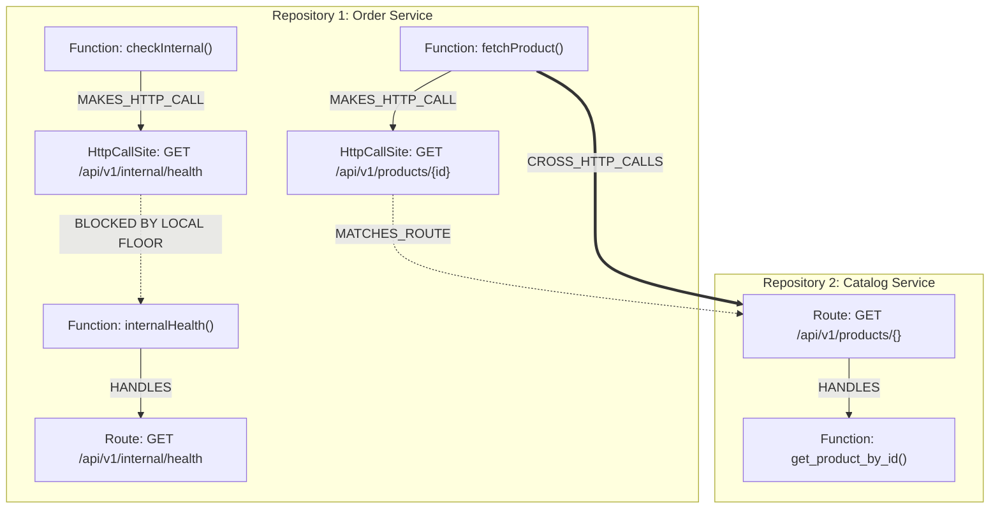
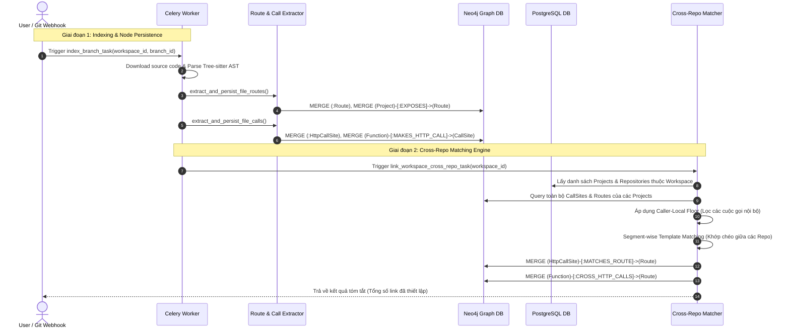

# Cross-Repository Intelligence Architecture & Specification

Tài liệu thiết kế kỹ thuật và hướng dẫn vận hành cho module **Cross-Repository Intelligence & Matching** trong nền tảng **Source Context**.

---

## 1. Tổng quan Kiến trúc (Architecture Overview)

Trong kiến trúc Microservices và Multi-repo, các service giao tiếp với nhau chủ yếu qua giao thức HTTP/REST RPC. Trước đây, hệ thống Code Graph chỉ phân tích trong phạm vi cục bộ của từng repository (In-repo Call Graph qua SCIP).

Module **Cross-Repository Intelligence** giải quyết bài toán liên kết xuyên biên giới giữa các repository trong cùng một Workspace:
- Tự động bóc tách **Server Routes** (API Endpoints) từ các framework web phổ biến.
- Tự động bóc tách **Client Call Sites** (Outgoing HTTP requests) từ các thư viện HTTP client phổ biến.
- Chuẩn hóa URL theo cấu trúc segment-wise (`normalizer`).
- Áp dụng nguyên lý **Caller-Local Floor** để triệt tiêu các liên kết sai (false positives).
- Dựng các cạnh quan hệ hai chiều `CROSS_HTTP_CALLS` trên cơ sở dữ liệu đồ thị **Neo4j**, cho phép truy vết chuỗi gọi từ Repository này sang Repository khác.



---

## 2. Neo4j Graph Data Model (Nodes & Relationships)

### 2.1. Các Node Mới

| Node Label | Mô tả | Các thuộc tính cốt lõi (Properties) |
| :--- | :--- | :--- |
| **`Route`** | Đại diện cho một API endpoint được server expose ra ngoài. | `uid`: Định danh duy nhất (`route__{project_id}__{method}__{path}`)<br>`method`: Phương thức HTTP (`GET`, `POST`, `PUT`, `DELETE`...)<br>`path`: Đường dẫn đã chuẩn hoá (`/api/v1/products/{}`)<br>`raw_path`: Đường dẫn nguyên bản trong code<br>`framework`: Framework web (`FastAPI`, `Flask`, `Express`...)<br>`protocol`: Mặc định `http` |
| **`HttpCallSite`** | Đại diện cho một lời gọi HTTP/RPC đi ra ngoài từ client. | `uid`: Định danh duy nhất (`call__{project_id}__{hash}`)<br>`method`: Phương thức HTTP (`GET`, `POST`...)<br>`raw_path`: URL hoặc chuỗi tham số thô trong code<br>`canonical_path`: Đường dẫn đã chuẩn hoá segment (`/api/v1/products/{}`)<br>`client_library`: Thư viện client (`axios`, `fetch`, `requests`, `httpx`)<br>`file_path`: Đường dẫn tương đối của file nguồn<br>`caller_name`: Tên hàm chứa lời gọi |

---

### 2.2. Các Quan Hệ Mới (Edges)

```mermaid
classDiagram
    direction LR
    class Project {
        uid: int
    }
    class Function {
        uid: str
        name: str
    }
    class Route {
        method: str
        path: str
        framework: str
    }
    class HttpCallSite {
        method: str
        canonical_path: str
        client_library: str
    }

    Project --> Route : EXPOSES
    Project --> HttpCallSite : CONTAINS_CALL
    Function --> Route : HANDLES
    Function --> HttpCallSite : MAKES_HTTP_CALL
    HttpCallSite ..> Route : MATCHES_ROUTE
    Function ==> Route : CROSS_HTTP_CALLS
```

| Tên Quan hệ (Relationship) | Chiều (Source $\to$ Target) | Ý nghĩa nghiệp vụ | Thuộc tính (Properties) |
| :--- | :--- | :--- | :--- |
| **`EXPOSES`** | `(:Project) $\to$ (:Route)` | Project công khai API endpoint này ra mạng. | Không có |
| **`HANDLES`** | `(:Function) $\to$ (:Route)` | Hàm thực thi logic xử lý request của route đó. | Không có |
| **`CONTAINS_CALL`**| `(:Project) $\to$ (:HttpCallSite)` | Project chứa đoạn code gọi HTTP này. | Không có |
| **`MAKES_HTTP_CALL`**| `(:Function) $\to$ (:HttpCallSite)`| Hàm cục bộ phát sinh lời gọi HTTP này. | Không có |
| **`MATCHES_ROUTE`**| `(:HttpCallSite) $\to$ (:Route)` | Lời gọi client khớp với endpoint của server. | `rule_level`: `exact_match` hoặc `param_pattern`<br>`matched_at`: Timestamp |
| **`CROSS_HTTP_CALLS`**| `(:Function) $\to$ (:Route)` | **Cạnh liên kết trực tiếp xuyên repo**: Hàm thuộc Repo A gọi API của Repo B. | `method`: Phương thức HTTP<br>`call_path`: URL thô đã gọi<br>`rule_level`: Cấp độ khớp<br>`matched_at`: Timestamp |

---

## 3. Luồng Hoạt động Toàn diện (Workflow)

Quy trình xử lý chia làm **2 giai đoạn** phối hợp giữa PostgreSQL, Tree-sitter AST, Celery Worker và Neo4j:



---

## 4. Các Giải thuật & Nguyên lý Cốt lõi

### 4.1. URL Canonicalization (`normalizer.py`)
Mỗi framework và ngôn ngữ có một cú pháp đặt tham số khác nhau. Hệ thống chuyển đổi tất cả về chuẩn **Wildcard Segment `{}`**:

1. **Bóc tách Base URL Variable ở đầu URL**:
   - `f"{self.base_url}/api/v1/billing/charge"` $\to$ `/api/v1/billing/charge`
   - `${CATALOG_BASE_URL}/api/v1/products/${id}` $\to$ `/api/v1/products/{}`
2. **Chuẩn hóa cú pháp tham số**:
   - Express / Fastify / NestJS: `:userId` $\to$ `{}`
   - FastAPI / OpenAPI: `{user_id}` $\to$ `{}`
   - Flask / Django: `<int:id>`, `<id>`, `<slug:name>` $\to$ `{}`
   - Next.js Dynamic Routes: `[id]`, `[...slug]` $\to$ `{}`
   - JavaScript Template Literals: `${userId}` $\to$ `{}`
3. **Chuẩn hóa Slash**: Loại bỏ double-slash (`//`) và trailing-slash (`/api/v1/users/` $\to$ `/api/v1/users`).

---

### 4.2. Segment-Wise Matching (`matcher.py`)
So khớp phân đoạn theo từng phần tử giữa mảng segment của Call Site và mảng segment của Server Route:

```python
call_segments  = ["api", "v1", "products", "prod_100"]  # hoặc {}
route_segments = ["api", "v1", "products", "{}"]
```
- Độ dài segment phải bằng nhau: `len(call_segments) == len(route_segments)`.
- Từng cặp segment: nếu một trong hai bên là `{}` (wildcard) thì luôn khớp; nếu là chuỗi cố định thì phải bằng nhau tuyệt đối.
- Cấp độ khớp (`rule_level`):
  - `exact_match`: Cả 2 bên đều là đường dẫn tĩnh, không có tham số.
  - `param_pattern`: Khớp thông qua tham số động `{}`.

---

### 4.3. Nguyên lý Caller-Local Floor (Bảo vệ Gọi Nội Bộ)

> [!IMPORTANT]
> **Caller-Local Floor** là giải thuật quan trọng nhất ngăn chặn hiện tượng liên kết ảo (*False Positives*) khi có nhiều repo trong một workspace.

**Kịch bản bài toán:**
- Repo 1 (Order Service) có endpoint nội bộ `GET /api/v1/internal/health` (hoặc `GET /metrics`).
- Repo 2 (Catalog Service) cũng có endpoint `GET /api/v1/internal/health`.
- Trong Repo 1, hàm `check_self_health()` gọi `GET /api/v1/internal/health`.

**Cách xử lý của hệ thống:**
1. Khi duyệt qua cuộc gọi của Repo 1, hệ thống kiểm tra trước trong danh sách Route của **chính Repo 1**.
2. Phát hiện Repo 1 đã có Route xử lý đường dẫn này.
3. Kích hoạt cờ **`[LOCAL FLOOR ACTIVE]`** $\to$ **Hủy bỏ matching xuyên repo** cho cuộc gọi này!
4. Cuộc gọi nội bộ không bao giờ bị nối nhầm sang Repo 2 hay các repo khác.

---

## 5. Hướng dẫn Tích hợp & Vận hành

### 5.1. Kích hoạt Tự động
Mỗi khi bạn trigger indexing một branch bất kỳ (`POST /api/v1/indexing/{workspace_id}/branch/{branch_id}`):
- Pipeline tự động bóc tách routes và call sites cho branch đó.
- Khi hoàn tất, worker tự động chạy ngầm task `link_workspace_cross_repo_task` để đồng bộ lại toàn bộ mạng lưới liên kết trong workspace.

---

### 5.2. REST API Quản trị

| Phương thức | Endpoint | Tham số | Mô tả |
| :--- | :--- | :--- | :--- |
| **`POST`** | `/api/v1/cross-repo/{workspace_id}/link` | `sync=true` hoặc `false` | Kích hoạt so khớp toàn workspace. Khi `sync=true`, trả về ngay kết quả JSON chi tiết. |
| **`GET`** | `/api/v1/cross-repo/{workspace_id}/links` | Không có | Lấy danh sách toàn bộ các liên kết cross-repo hiện có trong workspace. |
| **`DELETE`**| `/api/v1/cross-repo/{workspace_id}/links` | Không có | Xóa toàn bộ liên kết cross-repo cũ để chuẩn bị re-sync. |

---

## 6. Các Cypher Queries Hữu ích cho Neo4j

### 6.1. Xem toàn bộ mạng lưới gọi xuyên Repo
```cypher
MATCH (fn:Function)-[cr:CROSS_HTTP_CALLS]->(r:Route)
RETURN fn.name AS Caller_Function,
       cr.method AS Method,
       cr.call_path AS Call_URL,
       r.path AS Target_Route,
       r.framework AS Target_Framework
LIMIT 50;
```

### 6.2. Phân tích Tác động (Impact Analysis)
*Khi sửa một Route ở Repo B, những hàm nào ở Repo A sẽ bị ảnh hưởng?*
```cypher
MATCH (target_route:Route {path: "/api/v1/products/{}"})<-[:CROSS_HTTP_CALLS]-(caller_fn:Function)<-[:CONTAINS*1..3]-(caller_file:File)
RETURN caller_file.name AS Impacted_File,
       caller_fn.name AS Impacted_Function,
       target_route.path AS Route_Modified;
```

### 6.3. Truy vết chuỗi gọi xuyên qua nhiều microservice (Multi-hop Call Chain)
```cypher
MATCH path = (r1:Route)<-[:HANDLES]-(f1:Function)-[:CROSS_HTTP_CALLS]->(r2:Route)<-[:HANDLES]-(f2:Function)-[:CROSS_HTTP_CALLS]->(r3:Route)
RETURN path
LIMIT 10;
```
