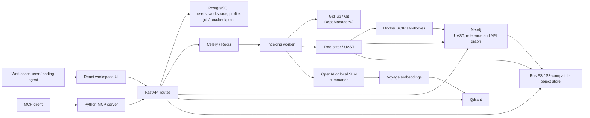
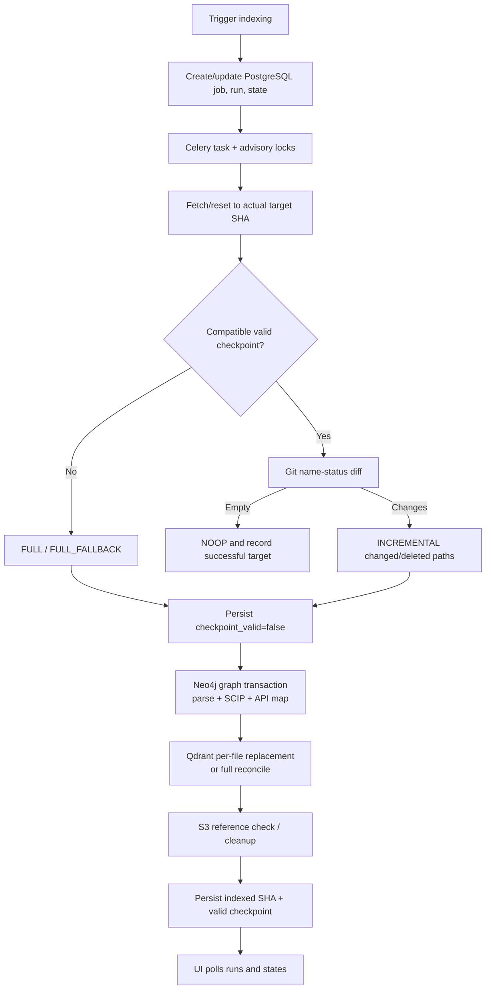

# Implementation & Improvement Report

**Repository:** `source-context`  
**Audit date:** 2026-11-13  
**Compared snapshot:** current working tree against the locally available default-branch snapshot `origin/master` at `32e184a9ba46f7c9ad53650534ccc34517669e7b`  
**Current branch/HEAD:** `feat/api-map` at `870f152f858512f1b2cb314f7891680ea455d4c3`

## Evidence and attribution

- **VERIFIED** means confirmed from current source, local Git refs/diffs, configuration, or test definitions.
- **REPORTED** means a result was stated in earlier implementation/audit notes but was not reproduced in this report task.
- **NOT VERIFIED** means code exists but this audit did not validate its behavior against a running integration or production-like environment.
- Git history records the repository evolution, not the identity of the person or agent responsible for each change. This report does not attribute every change to Codex.
- `origin/master` is a precise local comparison point, and `origin/HEAD` points to it. The configured upstream is `https://github.com/TuLe142857/source-context.git`; no fetch was performed, so this report does not assert that the local remote-tracking ref is the latest upstream commit.

## 1. Executive Summary

Source Context is a code indexing and retrieval platform. The baseline already contained a FastAPI backend, Celery jobs, Tree-sitter parsing/UAST, SCIP call-graph construction, Neo4j, Qdrant, an S3-compatible object client, OpenAI summarization, a React frontend, and an MCP server. The repository has since added or expanded private GitHub access, repository profiles, local inference, RustFS deployment configuration, graph dead-code queries, REST API mapping, a parser/graph/SCIP package reorganization, and an incremental indexing workflow.

The most significant operational change in the current working tree is the incremental index path: it compares a successful checkpoint with the checked-out commit, selects `FULL`, `INCREMENTAL`, `NOOP`, or `FULL_FALLBACK`, and scopes parsing/vector replacement to changed files where possible. It also adds durable job/run/checkpoint state and a frontend panel.

**Overall status: PARTIALLY IMPLEMENTED; NOT READY for multi-tenant production use.** The implementation is connected in source, but its most important cross-store and tenant boundaries have not been validated with real services. The audit also confirmed high-priority source-level risks: MCP vector endpoints do not enforce workspace authorization, project root paths are not confined to the checkout, API-map relinking queries every project, project configuration changes do not invalidate checkpoints, and workspace-batch enqueue failures can strand pending jobs.

This report documents **9 major implementations**:

| Status | Count | Meaning in this report |
|---|---:|---|
| COMPLETED | 2 | The structural refactor and frontend indexing integration are present and connected; prior static/build results are reported separately below. |
| PARTIALLY IMPLEMENTED | 6 | Core code exists, but behavior, operational setup, isolation, or recovery is incomplete or unverified. |
| NOT VERIFIED | 1 | The dead-code query is present, but no focused test or execution evidence was found in this audit. |

The repository comparison is against a verifiable Git snapshot, not an assumed clean-room reconstruction. The default snapshot predates the feature commits listed in Appendix A. Working-tree changes have unknown authorship and remain uncommitted.

## 2. Repository Overview

### 2.1 Original source and current baseline

The local default branch is `master`, at the same commit as `origin/master`. `origin/HEAD` also resolves to `origin/master`. The current feature branch contains 22 commits reachable after that baseline, including merge commits. The working tree additionally contains the incremental-index changes that are not committed at `HEAD`.

| Git comparison | Result |
|---|---|
| Baseline | `origin/master` — `32e184a9ba46f7c9ad53650534ccc34517669e7b` |
| Current committed HEAD | `870f152f858512f1b2cb314f7891680ea455d4c3` (`feat(api-map)`) |
| Committed baseline diff | 237 tracked path-change records; 15,154 insertions and 932 deletions using Git rename detection |
| Baseline path statuses | 101 added, 84 modified, 1 deleted, 51 renamed; 10 additional files are untracked in the current worktree |
| Current worktree delta from HEAD | 20 tracked files modified (1,615 insertions / 199 deletions) plus 10 untracked files; untracked files are excluded from `git diff --stat` |

The 51 rename records primarily reflect moving parser, SCIP, and graph code from `backend/app/parser`, `backend/app/scip`, and `backend/app/graph` into `backend/app/engine`. Counts use Git's rename-detection classification and should not be interpreted as exact counts of newly authored modules.

### 2.2 Current structure and technology

- `backend/`: Python 3.12+ FastAPI app, SQLAlchemy/PostgreSQL, Celery/Redis, Tree-sitter/UAST, SCIP, Neo4j/neomodel, Qdrant, Boto3 S3 client, repository managers and profile extraction.
- `frontend/`: React 19, TypeScript, Vite, React Query, Redux Toolkit, workspace/repository/branch/project views.
- `mcp/`: Python MCP server exposing graph, vector, repository overview, and API-map tools to coding agents.
- `docker/` and root Compose files: backend dependencies, SCIP sandbox images, and observability services.
- External integrations: GitHub/GitHub App, OpenAI or local `llama-cpp` inference, Voyage embeddings, Docker SCIP sandboxes, PostgreSQL, Neo4j, Qdrant, Redis, and S3-compatible storage.

The current backend dependency set adds `llama-cpp-python`, `cryptography`, and the PyJWT crypto extra relative to the baseline. The working-tree incremental changes do not modify `uv.lock` or `frontend/package-lock.json`.

### 2.3 Scope and ownership caveat

The committed branch history documents work such as Local SLM, RustFS, GitHub App, repository profiles, dead-code analysis, the engine refactor, and API map. The current uncommitted 30-file delta is the incremental-index implementation. Git cannot establish that any of these changes were authored by Codex, so the report describes observed evolution rather than authorship.

## 3. Implementation Summary

| Major implementation | Status | Main current files | Integration and verification state |
|---|---|---|---|
| Parser/SCIP/graph package refactor | **COMPLETED** | `backend/app/engine/{parser,scip,graph}/**`; CLI and task imports | Current application imports use `app.engine`; Git records mostly moves. Runtime test commands were not completed in this audit. |
| Local SLM provider and provider abstraction | **PARTIALLY IMPLEMENTED** | `backend/app/embedding/base.py`, `inference.py`, `local_slm_client.py`, `openai_client.py`, `backend/app/core/config.py` | OpenAI remains the default; local Phi-4-mini needs a separately supplied GGUF model and native runtime. No runtime inference test was run. |
| MinIO-to-RustFS Compose switch | **PARTIALLY IMPLEMENTED** | `docker-compose.yml`, `docker-compose.dev.yml`, `docker-compose.prod.yml`, `backend/app/core/s3.py` | Boto3 still speaks generic S3; dev/prod define RustFS volumes. No object-data migration or compatibility test is present. |
| GitHub App/private repository access | **PARTIALLY IMPLEMENTED** | `backend/app/services/github_app_service.py`, `backend/app/repository_manager_v2/manager.py`, `backend/app/repository_manager/resolver.py`, webhook routes and frontend | Installation/webhook/token/clone code is present. Live GitHub callback, webhook and private-clone flows were not tested. |
| Repository profile and overview | **PARTIALLY IMPLEMENTED** | profile extractor/providers, `RepoProfileDatabaseService`, profile models/routes, MCP general route, `OverviewPanel.tsx` | API/local profile paths exist; extractor coverage is primarily Python/JavaScript. No profile-focused current test was found. |
| Graph unused-code query | **NOT VERIFIED** | `backend/app/engine/graph/service.py`, `backend/app/api/mcp/graph.py`, `mcp/src/source_context_mcp/tools/graph.py` | Query depends on SCIP-generated `REFERENCE_TO` edges; no focused test or execution evidence was found. |
| REST API map | **PARTIALLY IMPLEMENTED** | `backend/app/engine/api_map/**`, `backend/app/engine/graph/model.py`, API routes and MCP tools | Python/JavaScript detectors, persistence, linking, REST endpoints and MCP tools exist. Tests/fixtures exist but were not run here; relinking is currently global rather than workspace-scoped. |
| Incremental index backend | **PARTIALLY IMPLEMENTED** | `backend/app/repository_manager/diff.py`, `backend/app/core/qdrant.py`, `backend/app/model/indexing_state.py`, `backend/app/services/indexing_service.py`, `backend/app/tasks/indexing.py`, migrations | Active worker code selects modes and updates stores/checkpoints. Real-service recovery and atomicity are unverified; several lifecycle gaps remain. |
| Incremental index frontend | **COMPLETED** | `frontend/src/api/indexing.api.ts`, `frontend/src/api/types/indexing.ts`, `frontend/src/hooks/useIndexing.ts`, `frontend/src/components/workspace/IndexingPanel.tsx` | Trigger, force-full action, polling, run/checkpoint display are wired. Previous build/lint passes are reported, not rerun here. |

## 4. Detailed Implementation Analysis

### 4.1 Incremental indexing and commit comparison

**Problem addressed:** the baseline indexing task scanned and persisted a project without a durable Git checkpoint or a commit-to-commit manifest. The current worktree adds `GitChangeManifest` and `select_indexing_mode` in `backend/app/repository_manager/diff.py`, plus commit verification and diff support in `RepoManagerV2`.

**Current workflow:**

1. `POST /indexing/{workspace_id}` or `POST /indexing/{workspace_id}/branch/{branch_id}` enters `IndexingService`, which validates workspace membership, creates `IndexingJob`/`IndexingRun`, updates `IndexingState`, commits PostgreSQL, and dispatches Celery.
2. The worker downloads/fetches the branch. Existing-clone fetch/reset errors propagate instead of allowing a stale local `HEAD` to be reported as the requested snapshot.
3. The worker compares the successful checkpoint SHA with the actual checked-out target, when the checkpoint is valid and version-compatible.
4. `FULL` rebuilds; `INCREMENTAL` parses added/modified/type-changed/renamed-new paths and removes deleted/renamed-old paths; `NOOP` skips storage stages; `FULL_FALLBACK` rebuilds when the checkpoint or diff cannot be trusted.
5. Neo4j project replacement runs in a transaction. SCIP and API-map work is still project-wide. Embeddings are generated for changed files in incremental runs, and full runs reconcile a project’s vectors.
6. The PostgreSQL indexed SHA and valid checkpoint are advanced after graph, Qdrant and S3 work returns successfully.

The active entry points are `backend/app/api/routes/indexing.py`, `IndexingService` in `backend/app/services/indexing_service.py`, and `execute_branch_indexing_pipeline`/`index_branch_task` in `backend/app/tasks/indexing.py`.

**Benefits:** avoided reprocessing unchanged files for parser/embedding work; auditable per-run mode, target/base SHA, stage and error; failed history comparison falls back to a full scan rather than trusting an incomplete diff.

**Limitations:** `Project.root_dir` and `language` are not part of checkpoint identity. Adding/updating/deleting a Project does not invalidate `IndexingState`; deleted Projects are not purged from all stores. Workspace batch dispatch can strand jobs if enqueue fails partway. A failed remote SHA lookup in the single-branch trigger may fall back to an old stored SHA and satisfy the `NOOP` fast path. SCIP remains full-project work, and Qdrant/graph readers do not gate reads on `checkpoint_valid`.

### 4.2 Qdrant point identity and replacement

In baseline `backend/app/core/qdrant.py`, a point UUID was derived from `node_id`; Qdrant errors could be logged and converted into a zero return count. Current code uses UUID5 over `code-node-v3`, workspace ID, branch ID, project ID, file path, node type, name, signature and byte range (`QdrantVectorStore.upsert_batch`). Payload now includes workspace/branch/project metadata.

`replace_file` upserts expected current IDs, scrolls the file’s target points and deletes obsolete IDs. `delete_file`, `reconcile_project_files` and `reconcile_legacy_points` provide deleted-file, full-project and attributable-legacy cleanup. Qdrant failures are propagated to the worker instead of silently reported as success. This improves target isolation and makes retries idempotent for the same identity; it does **not** make replacement atomic. The active worker stores absolute paths in the identity/payload, so IDs/path filters can change when the checkout root changes.

Tests in `backend/tests/unit/test_qdrant_vector_store.py` use mocked Qdrant clients. They cover deterministic identity, scoped deletes, obsolete cleanup and legacy metadata rules, but not real Qdrant behavior or concurrent external writers.

### 4.3 Neo4j graph, SCIP and API-map persistence

The baseline already contained parser/UAST, SCIP and graph-building code. The engine refactor moved it under `backend/app/engine/`. The current incremental work adds transactional project/file replacement helpers in `backend/app/engine/graph/persistence.py` and reuses existing project/file/node identities.

The worker sets `checkpoint_valid=false`, then enters a Neo4j transaction for graph deletion/replacement, parsing, SCIP call-graph construction, API-map persistence and API-map linking. The design preserves the old graph until transaction commit. `save_file_node` uploads source bytes to S3 before it writes the graph reference, so the S3 object is not part of the Neo4j transaction. After Neo4j commits, Qdrant and S3 cleanup run independently; a failure can leave the stores at different points in the target transition.

SCIP supports Python, JavaScript and TypeScript sandboxes in `backend/app/engine/scip/sandbox.py`; Java’s sandbox is commented out. If there is no sandbox, the task skips call-graph construction and attempts API-map detection without SCIP. A configured sandbox failure can fail graph generation. No real Neo4j rollback/visibility test was run.

### 4.4 REST API map and MCP tools

The API-map implementation adds API endpoint/call graph models and detectors for Python REST frameworks (including FastAPI) and JavaScript frameworks (including Express and NestJS). It uses source/CST patterns and optional SCIP context to infer routes, clients, anchors and matching targets. `backend/app/engine/api_map/build.py` detects and persists a project’s API nodes; `link.py` creates `RESOLVES_TO` relationships; `persist.py` replaces API nodes and their anchors.

The backend exposes project endpoint/call routes through `backend/app/api/mcp/api_map.py` and `GraphService`; `mcp/src/source_context_mcp/tools/api_map.py` exposes `list_api_endpoints_in_project` and `list_api_calls_in_project`. Pure detector tests and sample fixtures exist under `backend/tests/test_api_map/`; `test_neo4j_integration.py` also defines Neo4j integration coverage.

**Confirmed issue:** the indexing task names a local variable `workspace_project_ids` but selects all `Project.id` rows without a workspace predicate before calling `link_api_map`. The linker loads and clears relationships for every supplied project. This can create cross-workspace API edges and should be fixed before relying on workspace ownership boundaries.

### 4.5 Graph dead-code analysis

Commit `8a2d4f5` adds project/file unused-node endpoints to the graph service and MCP `graph` tool. The query only considers functions, methods and classes and excludes references contained within the same node’s own source span; it relies on `REFERENCE_TO` edges from SCIP. It does not cover variables/constants or prove semantic reachability. No focused tests for these new queries were found, so the result quality is **NOT VERIFIED**.

### 4.6 Repository profiles and workspace overview

The profile feature adds PostgreSQL `RepoProfile` and `SubrepoProfile` models, local-disk and GitHub API source providers, Python/JavaScript subproject extractors, a repository profile service, REST endpoints and MCP overview data. Profile fields include summary, language breakdown, topics/license, framework/stack information, entrypoints and directory maps. The indexing pipeline attempts profile extraction before graph indexing and logs rather than failing the index when that optional extraction fails.

Relevant code includes `backend/app/repository_manager_v2/profile_extractor/**`, `backend/app/services/repo_profile_service.py`, `backend/app/api/routes/repo_profiles.py`, `backend/app/services/general_service.py`, and `frontend/src/components/workspace/OverviewPanel.tsx`. The profile cache is keyed by commit/branch conditions. External GitHub requests and extractor coverage were not validated in this audit; no current dedicated profile test module was found.

### 4.7 GitHub App integration and private repositories

The GitHub App changes add installation/callback/status/unlink routes, webhook HMAC signature verification, installation-token handling, repository installation resolution, authenticated clone URLs and token sanitization. `RepoManagerV2` is used by indexing and profile extraction; workspace/repository UI changes expose the connection flow. Relevant files include `backend/app/services/github_app_service.py`, `backend/app/repository_manager_v2/manager.py`, `backend/app/repository_manager/resolver.py`, `backend/app/api/routes/webhooks.py`, and `frontend/src/components/workspace/RepositoriesPanel.tsx`.

The feature needs GitHub App credentials, webhook configuration and a live installation to work. Current tests cover URL parsing and a mocked manager failure, not webhook delivery, private clone against GitHub or installation-token authorization. Therefore the source path exists but live integration is **PARTIALLY IMPLEMENTED / NOT VERIFIED**.

### 4.8 Local SLM provider

The baseline inference implementation used OpenAI. The current branch adds a `BaseInference` contract, `OpenAIInference`, `LocalSLMInference`/`Phi4MiniInference`, and `LLM_PROVIDER` selection (`openai` or `local_slm`). `LOCAL_SLM_MODEL_PATH`, context length, thread count and GPU layer settings are configurable. The local path uses `llama-cpp-python` and a Phi-4-mini GGUF file; the model file is expected to be supplied separately. Voyage remains the embedding provider, so Local SLM only changes summarization/inference.

OpenAI remains the default. `backend/app/embedding/inference.py` imports the local client at module import time, so the `llama-cpp` native module is currently required even when OpenAI is selected. This coupling explains the test-collection error recorded in Section 7. No actual local model inference or quality/performance comparison was performed.

### 4.9 RustFS storage configuration

The original Compose service was MinIO. Current Compose files use `rustfs/rustfs:latest`, set the default S3 endpoint to `http://rustfs:9000`, and configure RustFS access/secret keys. The application client remains Boto3 against an S3-compatible endpoint, so no application storage API migration was needed. Development and production overrides define RustFS data volumes; the base Compose file has no enabled RustFS data mount. Credential and port environment variable names still contain `MINIO`.

No script or evidence of copying existing MinIO objects into RustFS was found. The production image is not pinned to a digest. S3 compatibility, restart persistence and actual bucket/object migration have not been tested. This is an infrastructure switch in configuration, not verified proof that existing data was migrated.

### 4.10 Frontend and MCP integration

The frontend already had workspace/repository/branch/project views. Later changes add private GitHub connection/profile presentation and API map tools to MCP. The incremental-index UI adds workspace/branch API clients and TypeScript contracts, React Query hooks keyed by workspace, polling, normal/full reindex actions, and run/checkpoint/fallback/error display. The implementation does not display fabricated intermediate percentages; backend `progress_pct` remains 0 until completion and then becomes 100.

Current UI limitations include no detailed query-loading error state in `IndexingPanel`, and the standalone `getIndexingRunApi` helper is not wired into a detail view. Earlier reports state the frontend build and lint passed; they were not rerun in this audit.

## 5. Original Source vs Current Implementation

| Area | Original behavior at `origin/master` | Limitation | Current implementation | Benefit and verification |
|---|---|---|---|---|
| Indexing | Celery task checked out a branch, scanned project files, persisted graph and generated vectors | No durable indexed SHA/run mode, no Git manifest-driven file selection, no checkpoint invalidation/recovery protocol | State/run models, Git diff parser, four modes, changed-file parsing/vector replacement and frontend run history | Saves parser/embedding work for unchanged files in code. No full pipeline test; cross-store integrity remains unverified. |
| Qdrant identity/errors | UUID based on UAST `node_id`; collection/upsert failures could be swallowed | Reparse/chunk changes or workspace reuse could collide/leave stale data; failures could appear as zero writes | Workspace/branch/project/path/structure UUID5, payload scoping, per-file replacement, stale cleanup and propagated exceptions | More repeatable retries and scoped cleanup. Mock tests exist; real service not validated. |
| Repository access | Existing Git client handled branch checkout; no current GitHub App installation-token flow was in the baseline | Private repository access tied to user/system credentials and lacked app lifecycle in this codebase | GitHub App webhook/callback/status, installation-token resolver and authenticated `RepoManagerV2` | Enables private repo workflow; live GitHub flow not tested. |
| LLM summarization | OpenAI-based implementation | No in-process local model option | Provider interface and local Phi-4-mini option, configurable model path/runtime | Choice of local inference can reduce dependency on remote summarization, but no measured cost/latency or model quality claim is made. |
| Object storage | MinIO service with a generic S3 client | MinIO-specific deployment; no RustFS configuration | RustFS Compose services and default endpoint with Boto3 retained | S3-compatible deployment alternative. No object migration/compatibility test; production image is unpinned. |
| Repository overview | No current profile/overview models and routes in baseline | Users/agents had to inspect repository structure separately | Cached repo/subproject profile, local/GitHub providers, REST/MCP overview and frontend panel | Consolidates architecture metadata; supported extractor set and live provider behavior are limited/unverified. |
| Graph/API intelligence | UAST/SCIP call graph and graph browsing existed | No API endpoint/client map or unused-code graph query in baseline | REST endpoint/call nodes, matching, MCP API map tools and unused-node query | Gives agents structured API/graph context. API map tests exist; no current run and workspace relinking scope is wrong. |
| Code-engine layout | Parser, SCIP and graph modules lived in separate top-level packages | Ownership/import boundaries were less cohesive | Modules moved beneath `backend/app/engine/{parser,scip,graph}`; API map is also under engine | Clearer domain grouping. This is primarily structural; no performance improvement is claimed. |
| Frontend index control | No run-mode/checkpoint panel in baseline | User could not inspect durable indexing runs through this UI | Trigger/full reindex, polling, run history and checkpoint display | Better operational visibility; the backend status is coarse and per-file/real-time progress is absent. |

## 6. Architecture Changes

### 6.1 Original architecture

At the comparison baseline, the backend already connected a full indexing task to Git checkout, Tree-sitter/UAST, SCIP/Neo4j, OpenAI summarization, Voyage embeddings, Qdrant and S3-compatible MinIO. The React frontend and MCP server exposed workspace, graph and vector operations. There was no incremental checkpoint/run flow or API-map subsystem in that baseline.

### 6.2 Current architecture

### 6.3 Indexing workflow as implemented

The diagrams describe source flow, not distributed atomicity. Neo4j commits before Qdrant reconciliation; S3 uploads happen before graph references, and cleanup happens later. No generation switch coordinates all readers.

## 7. Testing & Verification

### 7.1 Commands run in this report task

| Command/check | Result |
|---|---|
| Read-only Git status, branch/ref, history, diffs and baseline `git show` inspection | Completed; identified baseline and working-tree delta |
| `git diff --check` | Exit code 0; Git emitted only an LF-to-CRLF warning for `backend/app/repository_manager/diff.py` |
| Focused pytest for `test_git_diff.py`, `test_qdrant_vector_store.py`, `test_graph_persistence.py` with pytest cache and Python bytecode disabled | **Blocked during conftest import**: `ModuleNotFoundError: No module named 'llama_cpp'`. No tests ran. Import chain: `tests/conftest.py` → `app.main` → indexing task → embedding inference → `local_slm_client.py`. |
| Frontend build/lint, full backend suite, migrations, external services or indexing jobs | Not run in this report task |

Earlier audit notes report 26 focused backend unit tests, 3 repository-manager integration tests, compileall, Ruff `I,F`, frontend build and lint as passed. Those results were not reproduced here. Earlier notes also report full backend collection blocked by missing `llama_cpp` and no real-service tests. The current focused test attempt independently reproduces the `llama_cpp` collection blocker.

### 7.2 Test coverage present in the repository

- `backend/tests/test_parser/` and `backend/tests/test_chunking/`: parser semantics, Unicode/byte ranges, structural chunking and repository change handling.
- `backend/tests/test_api_map/`: Python/JavaScript pattern/framework/matching tests and sample repos; `test_neo4j_integration.py` defines Neo4j-backed coverage.
- `backend/tests/unit/test_git_diff.py`: NUL-delimited diff parsing and mode selection.
- `backend/tests/unit/test_qdrant_vector_store.py`: mocked Qdrant identity, filters, replace/reconcile and legacy cleanup.
- `backend/tests/unit/test_graph_persistence.py`: mocked S3 reference checks and transaction opt-out.
- `backend/tests/integration/test_repository_manager.py`: temporary local Git repository diff/rename and mocked fetch-failure propagation.
- `backend/tests/unit/test_github_url.py`: URL parser coverage, not GitHub App authorization or webhook integration.

No current focused tests were found for profile extraction persistence, GitHub App install/webhook lifecycle, local SLM inference, RustFS compatibility, full indexing orchestration, partial workspace enqueue failure, cross-store crash recovery, or project-config checkpoint invalidation.

## 8. Remaining Issues & Technical Debt

### Confirmed from source

1. **P0 — Vector tenant boundary:** `backend/app/api/mcp/vector.py` does not inject `CurrentAgent`; workspace search accepts an arbitrary workspace ID; branch search in `VectorService.search_with_branch_filter` passes only `branch_id`. `CodeRetriever` builds only the filters it receives. The app source does not enforce PAT/workspace membership for these routes.
2. **P0 — Project filesystem confinement:** `ProjectCreateRequest` and `ProjectUpdateRequest` accept arbitrary `root_dir`. The task joins it to the checkout and scans `rglob`; `Path.is_file()`/`read_bytes()` follow file symlinks. No resolved-path containment guard is present.
3. **P1 — API-map scope:** `tasks/indexing.py` selects every `Project.id` before workspace linking. `link_api_map` loads/clears all supplied projects.
4. **P1 — Project lifecycle/checkpoint:** project create/update/delete do not invalidate the branch checkpoint. Deleted project data is not deleted from Neo4j/Qdrant/S3 by the project deletion service or a later rebuild of remaining projects.
5. **P1 — Workspace enqueue failure:** jobs/runs are committed before sequential Celery dispatch. If dispatch throws, undispatched later jobs remain pending; the failure handler only marks the current job/run failed.
6. **P1 — Remote SHA false no-op:** `get_latest_commit_hash` returns `None` on lookup failure. Single-branch service can fall back to stored `branch.commit_hashed` and match the checkpoint before the worker runs.
7. **P1 — Visible cross-store partial state:** reads do not check `checkpoint_valid`; Qdrant is replaced file by file after Neo4j commits.
8. **P2 — Eager native dependency:** inference imports `local_slm_client` at module load, which imports `llama_cpp` even when the configured provider is OpenAI.
9. **P2 — RustFS rollout evidence:** no object-copy/migration script was found, production uses `rustfs/rustfs:latest`, and the base Compose file has no enabled RustFS data mount. The dev/prod overlays do declare volumes.
10. **P2 — Long-running work/observability:** SCIP is full-project and inside the Neo4j transaction; one global advisory lock serializes all indexing; progress is only 0/100 and stale recovery has no heartbeat.

### Not established by this source audit

- Whether Neo4j transaction rollback behaves as intended under the deployed Neo4j/neomodel versions.
- Whether RustFS accepts all current S3 operations/configuration and preserves existing object data through rollout.
- Whether real Qdrant scroll/delete paging and retries converge under concurrent readers/writers.
- Whether the configured SCIP Docker images are present in every worker environment and whether their output covers every persisted file.
- Whether private GitHub installation, webhook and callback flows succeed with production secrets.

## 9. Recommended Next Steps

| Priority | Recommendation | Expected benefit |
|---|---|---|
| **P0** | Enforce PAT authentication and workspace membership on both MCP vector routes. Require workspace scope for branch search and apply both `workspace_id` and `branch_id` filters. | Prevents cross-workspace vector retrieval and unauthenticated search through the application API. |
| **P0** | Validate `root_dir` as a relative in-checkout path and verify resolved roots/files do not escape through `..`, absolute paths or symlinks before reading, parsing, embedding or uploading. | Prevents indexing arbitrary worker filesystem paths. |
| **P1** | Scope API-map project selection to the active workspace and add a test that rejects cross-workspace `RESOLVES_TO` edges. | Keeps API maps within the intended workspace/project set. |
| **P1** | Include Project configuration in checkpoint validity; invalidate on create/update/delete and reconcile graph, vectors and source artifacts for deleted projects. | Ensures indexing responds to project configuration changes even when Git SHA is unchanged. |
| **P1** | Make workspace batch dispatch recoverable: every committed run must be queued or set to a terminal/retryable state; update branch status consistently. | Prevents orphan PENDING runs after partial enqueue failures. |
| **P1** | Do not report `NOOP` if remote target SHA could not be verified; return a retryable error or enqueue a worker that performs the authoritative fetch. | Avoids false freshness after GitHub/network lookup failures. |
| **P1** | Add isolated orchestration and failure-injection integration tests for PostgreSQL state, Neo4j transaction, Qdrant replacement and S3 cleanup. Make the test environment importable without loading the local SLM unless selected. | Provides evidence for the recovery claims and removes the current collection blocker. |
| **P2** | Pin RustFS image versions and document/test MinIO-to-RustFS data migration and rollback; keep dev/prod storage persistence explicit. | Makes storage rollout reproducible and protects existing objects. |
| **P2** | Load local SLM lazily and expose accurate progress/heartbeat; measure SCIP and lock duration before optimizing. | Improves installation/test ergonomics and makes recovery/throughput observable. |
| **P3** | Expand SCIP language coverage only after the supported parser/indexer matrix is documented and validated. | Avoids adding language names without full graph/index coverage. |

## 10. Final Assessment

Compared with `origin/master`, the current repository adds meaningful code intelligence and operational features: private GitHub access, optional local summarization, repository profiles, RustFS Compose configuration, graph dead-code queries, a REST API map with MCP exposure, and incremental index control with durable run/checkpoint records. The parser/SCIP/graph reorganization improves code grouping, while the current Qdrant changes improve deterministic, target-scoped file replacement and error propagation.

The strongest user-facing improvements are API-map discovery, repository overview, optional local inference, and UI visibility into indexing runs. The strongest backend improvement is incremental parsing/vector replacement guided by a checked Git diff. No benchmark was run, so no quantitative performance claim is made.

**Maturity:** substantial implementation, incomplete integration verification. The repository is **NOT READY for production multi-tenant indexing** until P0 workspace/filesystem boundaries and P1 lifecycle/dispatch correctness are addressed, migrations are applied through a controlled deployment process, and the cross-store workflow is exercised against real or controlled test services.

## 11. Appendix

### A. Selected Git history

These commits identify feature areas in the branch history; they do not prove authorship:

| Commit | Area |
|---|---|
| `991b3c0` | Local SLM provider implementation |
| `1aa3acf` | MinIO-to-RustFS Compose change |
| `b00d9ee` | GitHub App integration |
| `9af9332`, `77e40fc` | Repository profile/overview work |
| `8a2d4f5` | Unused-code graph/MCP feature |
| `08a42d9` | Parser/SCIP/graph move into `app.engine` |
| `0b4a827`, `c534aa9` | API-map design and REST detection |
| `37db542` | API-map backend route/query support |
| `870f152` | API-map MCP tools |
| Current uncommitted worktree | Incremental indexing, checkpoint, Qdrant replacement, migration and frontend panel changes |

### B. Current working-tree file inventory

**Tracked modified (20):**

- `backend/app/api/routes/indexing.py`
- `backend/app/core/qdrant.py`
- `backend/app/embedding/embedding_pipeline.py`
- `backend/app/embedding/utils.py`
- `backend/app/engine/api_map/build.py`
- `backend/app/engine/api_map/link.py`
- `backend/app/engine/api_map/persist.py`
- `backend/app/engine/graph/build.py`
- `backend/app/engine/graph/save_node.py`
- `backend/app/model/__init__.py`
- `backend/app/repository_manager/diff.py`
- `backend/app/repository_manager_v2/manager.py`
- `backend/app/schemas/indexing.py`
- `backend/app/services/indexing_service.py`
- `backend/app/tasks/indexing.py`
- `backend/tests/integration/test_repository_manager.py`
- `frontend/src/api/indexing.api.ts`
- `frontend/src/api/types/indexing.ts`
- `frontend/src/components/workspace/IndexingPanel.tsx`
- `frontend/src/hooks/useIndexing.ts`

**Untracked additions (10):**

- `backend/app/engine/graph/persistence.py`
- `backend/app/indexing/version.py`
- `backend/app/model/indexing_state.py`
- `backend/docs/incremental-index.md`
- `backend/migrations/0001_incremental_index_state.sql`
- `backend/migrations/0002_indexing_checkpoint_valid.sql`
- `backend/migrations/README.md`
- `backend/tests/unit/test_git_diff.py`
- `backend/tests/unit/test_graph_persistence.py`
- `backend/tests/unit/test_qdrant_vector_store.py`

### C. Important configuration changes

- LLM: `SOURCE_CONTEXT_LLM_PROVIDER`, `SOURCE_CONTEXT_LOCAL_SLM_MODEL_PATH`, `SOURCE_CONTEXT_LOCAL_SLM_N_CTX`, `SOURCE_CONTEXT_LOCAL_SLM_N_THREADS`, `SOURCE_CONTEXT_LOCAL_SLM_N_GPU_LAYERS`.
- GitHub App: `SOURCE_CONTEXT_GITHUB_APP_ID`, private-key path/key, webhook secret, and frontend app name. Compose mounts the private key read-only in backend and worker.
- Object storage: `SOURCE_CONTEXT_S3_ENDPOINT` defaults to `http://rustfs:9000`; access/secret and port variables retain `MINIO` names.
- Dependencies: `llama-cpp-python`, `cryptography`, and `pyjwt[crypto]` were added/adjusted in backend metadata; `uv.lock` changed in the committed feature history.
- Incremental DB migrations: manual SQL scripts `0001` then `0002`; app startup uses `Base.metadata.create_all()` and does not upgrade existing databases.

### D. Main incremental-index code references

- Diff parsing/mode selection: `backend/app/repository_manager/diff.py` (`GitChangeManifest`, `parse_name_status_z`, `select_indexing_mode`).
- Checkout and commit comparison: `backend/app/repository_manager_v2/manager.py` (`clone_or_update_branch`, `compare_commits`).
- Point identity/reconciliation: `backend/app/core/qdrant.py` (`upsert_batch`, `replace_file`, `reconcile_project_files`, `reconcile_legacy_points`).
- Durable model/version: `backend/app/model/indexing_state.py`, `backend/app/indexing/version.py`.
- Trigger/API logic: `backend/app/api/routes/indexing.py`, `backend/app/services/indexing_service.py`, `backend/app/schemas/indexing.py`.
- Worker stages and checkpoint: `backend/app/tasks/indexing.py` (`download_branch_source_stage`, `parse_tree_sitter_ast_stage`, `run_scip_and_build_graph_stage`, `build_vector_embeddings_stage`, `execute_branch_indexing_pipeline`, `index_branch_task`).
- Graph/S3 helpers: `backend/app/engine/graph/persistence.py`, `backend/app/engine/graph/save_node.py`.
- UI: `frontend/src/components/workspace/IndexingPanel.tsx`, `frontend/src/hooks/useIndexing.ts`, `frontend/src/api/indexing.api.ts`.
